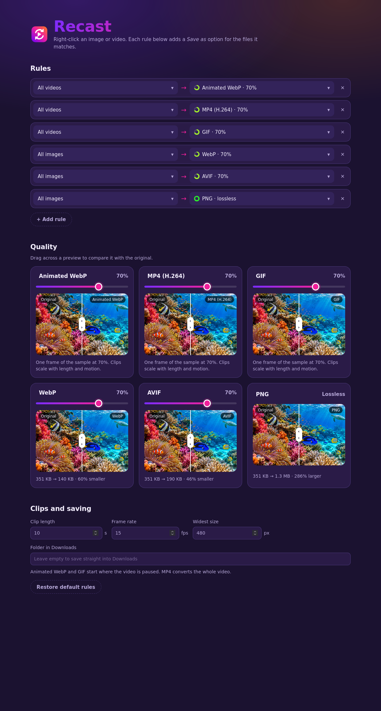
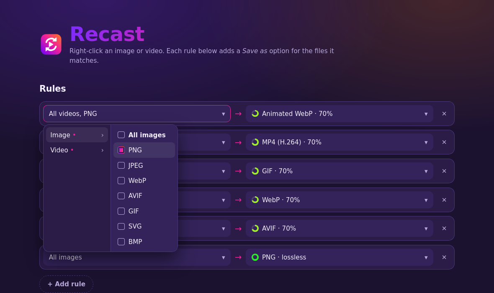
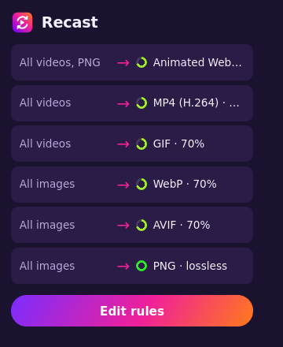

# Recast

Firefox extension: right-click an image or video, save it in another format according to your rules.

- `ext/` — the extension. `config.js` holds every source format, target format and default; nothing else hard-codes them.
- `build.mjs` — copies FFmpeg and AVIF encoders into `ext/vendor/`, generates the quality ring icons. `--pack` also builds `dist/*.zip`.
- `scripts/smoke.mjs` — loads the extension into the bundled Firefox (`.browser/`), converts a real video and image through every target and screenshots the UI into `.smoke/`.
- `design/` — icon source and listing art.

## Screenshots





## Test locally

With Node.js and Firefox installed, run:

```sh
git clone https://github.com/MintOcha/recast.git
cd recast
npm ci
npm run build
npx web-ext run --source-dir ext
```

This opens Firefox with Recast temporarily installed. Right-click an image or video and try a Save as rule. With the folder setting blank, files go directly to Firefox’s download folder.

For the automated checks, put an unsigned-extension-capable Firefox build at `.browser/firefox/firefox`, then run `npm run smoke` or `node scripts/e2e.mjs`. Run `npm run pack` to build the AMO ZIP in `dist/`.

To recapture the listing screenshots without running the conversion suite, run `npm run smoke -- --screenshots`. Captures go into `.smoke/screenshots/`.

Third-party: `@ffmpeg/core` (GPL-2.0-or-later), `@ffmpeg/ffmpeg` (MIT), `@jsquash/avif` (Apache-2.0). Recast is GPL-3.0-only (compatible with all three).
